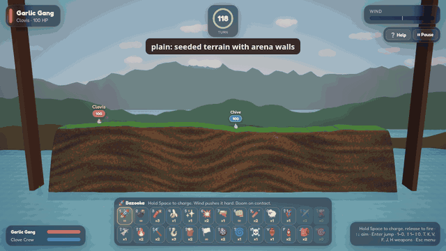
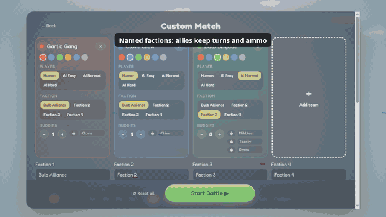
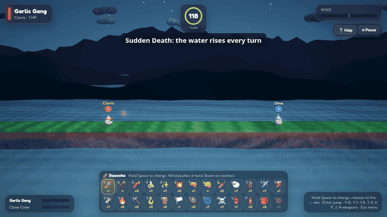
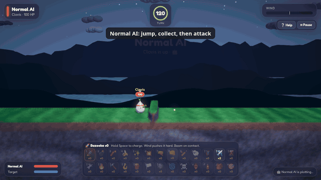
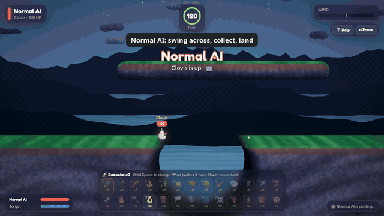

# Current media and documentation

The gallery was refreshed for **1.83.2**, using the gameplay delivered in **1.83.1**. Screenshots,
GIFs and social videos are rendered by the actual game. Authored arenas position buddies, crates
and obstacles so a recording reliably demonstrates its subject; actions still use the core rules.
They are demonstrations, not recordings of unscripted player matches. Seeded weapon/feature
fixtures repeat their actions; the live title/demo background and GPU particles can vary between
recordings.

## Feature animations

### Adaptive landscapes

All four seeded terrain families, with the arena walls enabled:



### Factions

Named factions in setup, active friendly fire and a shared victory:



### Sudden Death water

Water rises once per turn and eventually drowns buddies on low ground:



### AI collecting a nearby crate

Normal jumps an obstacle, takes the health supply and then calls its aircraft attack:



### AI using a rope

A checked traversal across a gap, collecting the crate and releasing the rope:



The [weapon gallery](weapons_preview.md) contains all 26 weapons, including the jetpack and homing
rocket. The [README](../README.md#more-screenshots) contains the general screenshot gallery.

## Reproduce the entire refresh

Install project dependencies, Google Chrome, Playwright Firefox, ffmpeg/ffprobe and Python with
matplotlib. On a Linux host without a display, install Xvfb as well.

```bash
npm install
npx playwright install chrome firefox
npm run refresh-media
```

The command builds the current package, starts its own preview on port 4174, captures all media,
checks coverage, redraws the history chart and writes the manifest. It stops its preview on exit.
After selectively recapturing affected files, use `npm run refresh-media -- --metadata-only` to
validate the existing media and refresh coverage, chart and provenance without another recording.
An already running preview can be supplied with `npm run refresh-media -- http://localhost:4174`;
the Chrome capture helpers reject a build whose displayed version differs from package.json.

Capture commands can also be run separately against a preview. Append weapon ids to
`capture-weapons` or feature ids to `capture-features` to record selected clips; for example,
`npm run capture-features -- http://localhost:4174 factions`. Feature checks still simulate all
scenarios to verify their outcomes.

```bash
npm run capture-media -- http://localhost:4174
npm run capture-weapons -- http://localhost:4174
npm run capture-features -- http://localhost:4174
xvfb-run -a node scripts/check-firefox-fire.mjs http://localhost:4174
node linkedin/capture-clip.mjs http://localhost:4174
node linkedin/capture-clip-b.mjs http://localhost:4174
node linkedin/capture-clip-c.mjs http://localhost:4174
python3 scripts/history_chart.py --no-measure
npm run media-manifest
```

For faster Chrome capture on a desktop, set `ALLIUM_CAPTURE_HEADED=1`. Without a display, prefix
that command with `xvfb-run -a`; the complete refresh command handles this automatically. The
headed path uses the available GPU. The default individual Chrome scripts retain SwiftShader as a
headless fallback. Headed Firefox uses its ordinary WebGL preferences.

## What each script owns

| Script                           | Outputs                                                                |
| -------------------------------- | ---------------------------------------------------------------------- |
| `scripts/capture-media.mjs`      | README JPEG screenshots and `screenshots/battle.gif`                   |
| `scripts/capture-weapons.mjs`    | One GIF per selectable weapon in `weapons/`                            |
| `scripts/capture-features.mjs`   | Five feature GIFs and four landscape screenshots                       |
| `scripts/check-firefox-fire.mjs` | Three Firefox fire PNGs at two quality budgets/resolutions             |
| `scripts/history_chart.py`       | `screenshots/history.png` and measured coverage cache                  |
| `linkedin/capture-clip*.mjs`     | Three MP4 social clips and their JPEG posters                          |
| `scripts/media-manifest.mjs`     | File hashes, dimensions, frame counts, duration and capture provenance |

Weapon GIFs use 480-pixel width, ten frames per second and up to 96 colours. Feature GIFs use
640-pixel width; the battle clip uses 640 pixels and twelve frames per second. The final jetpack
descent is shortened by advancing the real simulation, then showing its safe landing. Social
videos keep the existing 1080×1350, H.264/AAC format and scripted captions; their audio track is
silent. Game sounds remain synthesized live in Web Audio.

The scripts assert real outcomes: detonation, damage, crate pickup, guidance, rope attachment and
release, jetpack landing, flooding and shared victory. Browser errors fail a capture. The
[manifest](media-capture.json) inventories every checked-in media asset with its SHA-256 and format
facts. It records the game source fingerprint and build entry hash, avoiding an unsupported claim
that an uncommitted capture already belongs to a future Git commit.

The history chart describes committed repository history through the last gameplay commit used
for the refresh. Only a verified current coverage report is added to that commit's cache when the
core sources match HEAD. Historical measurements and archived prose keep their original dates.

## Markdown review — 14 October 2026

All tracked Markdown was reviewed for current claims, local targets and media references:

| Documents                               | Review result                                                                                 |
| --------------------------------------- | --------------------------------------------------------------------------------------------- |
| Root README and AGENTS                  | Current controls, inventories, capture commands, test gate and media guidance                 |
| CHANGELOG and tasks                     | Preserve historical entries; add this refresh and repair moved-document links                 |
| Vision and architecture                 | Correct AI rope behavior, faction victory, jetpack phases and navigation components           |
| Documentation index                     | Identify the active plan and add this media guide                                             |
| Performance                             | Date historical comparisons, record the current production bundle and benchmark smoke run     |
| I18N and sound                          | Correct test references and distinguish game-generated audio from social-video tracks         |
| Plan and review                         | Record the execution plan, findings, faction-input contrast fix and verification limits       |
| Touchscreen study                       | Remains unimplemented; update its proposed controls for the current arsenal                   |
| Contributing and security               | Repair relative paths, raise the stated coverage threshold and correct audit/privacy claims   |
| Archived research and September backlog | Preserve historical decisions and numbers; mark archival scope and repair moved links         |
| LinkedIn README and drafts              | Refresh current copy and captions; keep the earlier final post/research explicitly historical |

Local file/image links are checked by `tests/docs.test.ts`. External research in archived material
is historical evidence, not a newly verified recommendation. Browser regressions cover
representative behavior; neither a media capture nor 98% coverage proves every possible match.
